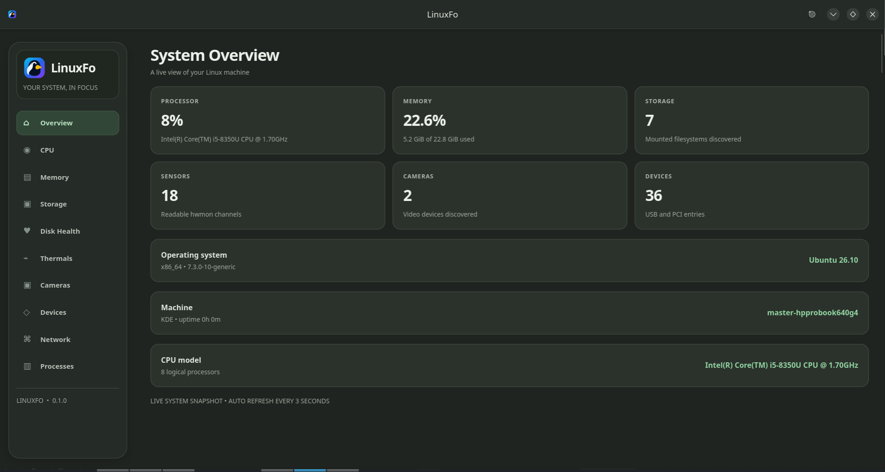
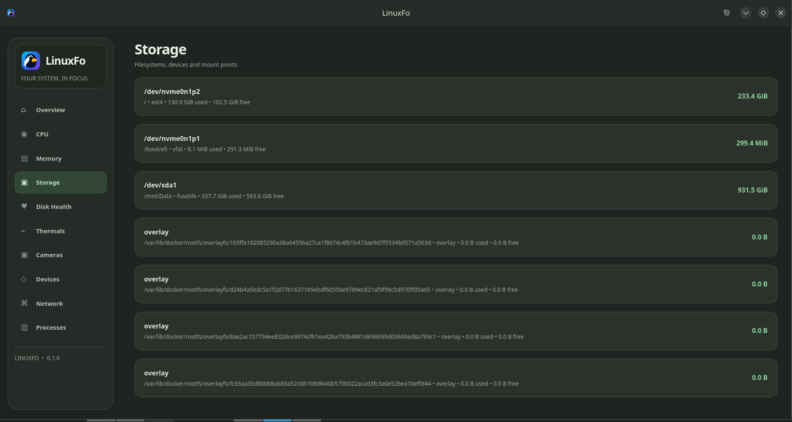
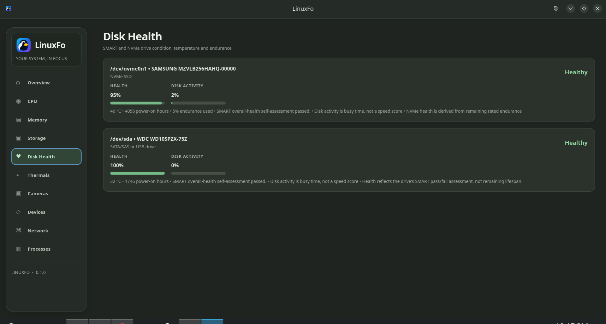

# LinuxFo

LinuxFo is a cross-distribution Linux system information centre. It brings hardware, operating-system, resource, storage, sensor, camera, network, and device diagnostics into one desktop application.

## Screenshots

### System Overview



### Storage



### Disk Health



## Goals

- One coherent GTK desktop experience across Debian/Ubuntu, Fedora, Arch, openSUSE, Alpine, and other Linux distributions.
- Native builds for x86_64 and ARM64, with ARMv7 considered where the toolchain and dependencies permit.
- No assumptions about a particular package manager, init system, desktop environment, or sensor chipset.
- Capability-based discovery: unavailable hardware and permission-limited interfaces are reported honestly rather than treated as fatal errors.
- Reproducible CI builds, portable archives, distribution packages, and versioned GitHub releases.

## Technology

LinuxFo is written in Rust with GTK4/libadwaita. Linux hardware data is collected through standard kernel interfaces (/proc, /sys, udev where available) and optional utilities. The UI and collectors are separated so missing utilities or inaccessible devices cannot crash the application.

## Build targets and packaging

GitHub Actions validates native GTK builds on x86_64 and AArch64. Version tags publish compressed binaries and SHA-256 checksums. Debian package builds target amd64/arm64; Fedora RPM and Arch PKGBUILD packaging have dedicated workflows. All native desktop packages require compatible GTK4/libadwaita runtime libraries. See [packaging/README.md](packaging/README.md) for the packaging matrix and limitations.

## Install on Debian / Ubuntu

Download the matching package from the GitHub Releases page:

- `linuxfo_<version>_amd64.deb` for Intel/AMD 64-bit PCs.
- `linuxfo_<version>_arm64.deb` for 64-bit ARM systems.

Install it with APT so required GTK4 and libadwaita runtime libraries are installed automatically:

```bash
sudo apt install ./linuxfo_<version>_amd64.deb
```

For ARM64, use the `arm64` package filename instead. You can also install a downloaded package with:

```bash
sudo apt --fix-broken install
```

Launch LinuxFo from your desktop application menu or run `linuxfo` in a terminal.

The raw CI binary is not a self-contained executable: it needs GTK4 and libadwaita installed by the operating system. Prefer the Debian package over copying the raw binary.

## Changelog

See [CHANGELOG.md](CHANGELOG.md) for release notes and project changes.

## Development

See CONTRIBUTING.md and docs/architecture.md.

Run locally with `cargo run -p linuxfo` after installing Rust and GTK4/libadwaita development libraries.

## Hardware visibility

Linux exposes hardware information through kernel interfaces, firmware tables, drivers, and optional userspace tools. No application can promise every sensor or camera on every machine: some devices require vendor drivers, firmware support, elevated permissions, or APIs unavailable in a particular environment. LinuxFo surfaces source and availability for each reading.


## Live monitoring and camera permissions

LinuxFo keeps a single system monitor alive while the window is open. CPU percentages and per-process CPU/RAM values are calculated from successive kernel samples and refresh every three seconds. The Processes page shows the busiest processes first and includes search by process name, PID, or status, plus confirmation-protected Kill and Restart actions. Process actions use the current user's permissions; restarting systemd-managed services may require service-specific handling.

Camera discovery is intentionally passive: LinuxFo lists `/dev/video*` nodes and checks the current user's read permission without opening the camera or starting a stream. On many distributions, camera nodes are assigned to the `video` group. If the Cameras page reports missing permission, an administrator can add the current account to that group:

```bash
sudo usermod -aG video "$USER"
```

Sign out and sign back in for the group change to take effect. Some distributions use a different device group or access policy; follow the permissions shown for the actual device. Native Debian packages do not use Flatpak's camera permission portal.

## License

LinuxFo is open source software licensed under the [MIT License](LICENSE).

Copyright (c) 2026 Muhammad Hamza Mushtaq.

You are free to use LinuxFo for personal or commercial purposes, study it, modify it, and redistribute original or modified copies. When redistributing the software or substantial portions of it, you must retain the copyright notice and MIT permission notice. The license does not transfer ownership of the copyright or require you to release your modifications.

The software is provided "as is", without warranty. See the [LICENSE](LICENSE) file for the complete terms.

